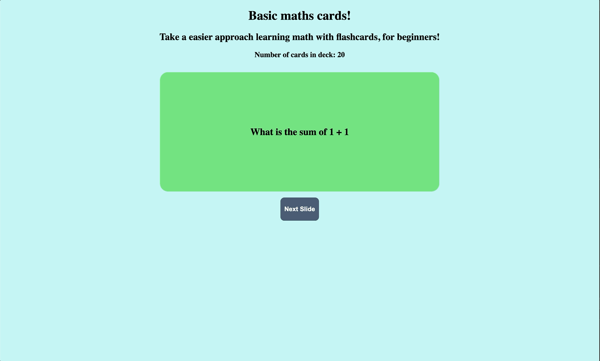

# WEB102 Project 2 - Flashcard App

A simple and interactive math flashcard application built using React and Vite. Users can practice math questions, flip flashcards to reveal answers, and navigate through different questions.

## Features

- Interactive flashcards with flip animations
- Randomly generated flashcard selection
- Displays math questions and answers
- Responsive user interface
- Built with reusable React components

## Technologies Used

- **React** - Frontend JavaScript library
- **JavaScript** - Application logic
- **HTML** - Page structure
- **CSS** - Styling and animations
- **Vite** - Development and build tool

## Getting Started

Follow these steps to run the application locally.

### 1. Clone the Repository

```bash
git clone https://github.com/SamM-SWE/WEB102-PROJECT2.git
```

### 2. Navigate to the Project Directory

```bash
cd WEB102-PROJECT2
```

### 3. Install Dependencies

Make sure you have Node.js and npm installed.

```bash
npm install
```

### 4. Start the Development Server

```bash
npm run dev
```

### 5. Open the Application

Open the local URL displayed in your terminal, typically:

```text
http://localhost:5173
```

## How to Use

1. Open the application in your browser.
2. Read the question displayed on the flashcard.
3. Click the flashcard to reveal the answer.
4. Click again to return to the question.
5. Generate another flashcard to continue practicing.

## Project Preview



## Author

**Samuel Monneh**

GitHub: [SamM-SWE](https://github.com/SamM-SWE)
